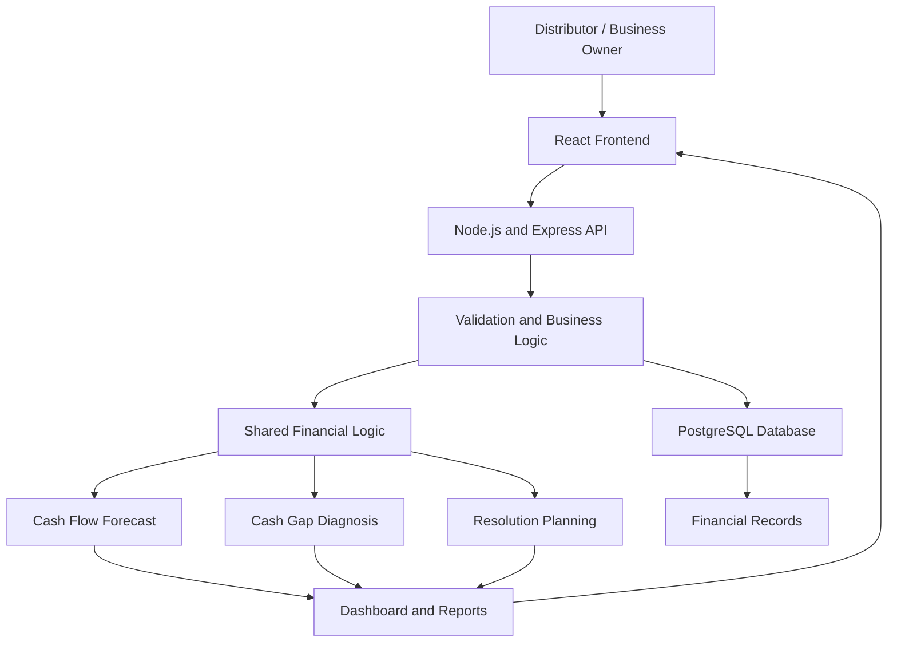

# FlowBridge
### Cash Gap Resolution Engine

**Predict cash shortages. Understand why they happen. Discover how to resolve them.**

FlowBridge is a financial decision-support platform designed for small distributors who face cash-flow problems because customer payments and supplier obligations occur at different times.

A business can be profitable and still run out of cash.

FlowBridge helps distributors anticipate liquidity shortages, identify the transactions causing them, evaluate possible resolutions, manage financial commitments and verify payment outcomes.

---

## Table of Contents

1. [Overview](#-overview)
2. [The Problem](#-the-problem)
3. [Our Solution](#-our-solution)
4. [How FlowBridge Works](#-how-flowbridge-works)
5. [Core Features](#-core-features)
6. [Financial Intelligence](#-financial-intelligence)
7. [System Architecture](#-system-architecture)
8. [Technology Stack](#-technology-stack)
9. [Project Structure](#-project-structure)
10. [Getting Started](#-getting-started)
11. [Environment Configuration](#-environment-configuration)
12. [Demo Scenario](#-demo-scenario)
13. [Data Integrity and Security](#-data-integrity-and-security)
14. [Current Limitations](#-current-limitations)
15. [Future Roadmap](#-future-roadmap)
16. [Contributing](#-contributing)
17. [Disclaimer](#-disclaimer)

---

## 🚀 Overview

Small distributors frequently purchase goods from suppliers on credit and sell those goods to retailers who pay later.

The timing mismatch creates a serious financial challenge.

For example:

- A supplier expects ₹95,000 on Day 5.
- Operational expenses of ₹15,000 are also due on Day 5.
- The distributor currently has ₹80,000.
- A retailer is expected to pay ₹60,000 on Day 10.

The business expects money to arrive, but it arrives too late.

**The result is a ₹30,000 cash shortage on Day 5.**

Traditional financial dashboards mainly report balances and historical transactions. FlowBridge focuses on the timing of future cash movements and the actions that can help prevent a shortage.

### Product philosophy

FlowBridge follows five principles:

- Predict before the shortage happens.
- Explain the financial reason behind every warning.
- Evaluate possible resolutions before taking action.
- Track commitments and their progress.
- Verify actual outcomes before updating financial records.

---

## ❗ The Problem

Small distributors often manage their financial operations using spreadsheets, accounting software, bank statements and manual follow-ups.

This creates several challenges:

### 1. Cash-flow timing mismatch
Customer receivables may arrive after supplier payments become due.

### 2. Late identification of shortages
Business owners may discover a liquidity problem only when a payment is due.

### 3. Lack of explainability
A declining cash balance does not automatically explain which invoices, supplier bills or expenses are responsible.

### 4. Payment identification difficulties
Distributors may receive payments without knowing which retailer made the transfer.

### 5. Fragmented financial operations
Forecasting, payment verification, retailer tracking and financial commitments are often handled separately.

### 6. Uncertain financial decisions
Business owners need to evaluate possible actions before changing payment schedules or using emergency reserves.

---

## 💡 Our Solution

FlowBridge brings cash-flow forecasting, financial diagnosis, resolution planning and payment verification into one platform.

It helps answer five important questions:

| Question | FlowBridge capability |
|---|---|
| How much cash is available? | Financial position |
| When could cash become insufficient? | Cash-flow forecasting |
| Why will the shortage happen? | Explainable diagnosis |
| What can be done about it? | Resolution planning |
| Did the action actually work? | Commitment and payment verification |

FlowBridge is not intended to replace accounting software. It adds a forward-looking financial decision-support layer to distributor operations.

---

## 🔄 How FlowBridge Works

The product follows a continuous operational cycle:

**PREDICT → EXPLAIN → RESOLVE → TRACK → VERIFY**

### 1. Predict
Analyse available cash, expected receipts and upcoming obligations to identify potential cash shortages.

### 2. Explain
Identify the invoices, supplier bills and expenses contributing to the projected shortage.

### 3. Resolve
Evaluate possible financial actions and their impact on future liquidity.

### 4. Track
Monitor proposed and agreed commitments, payment expectations and their progress.

### 5. Verify
Compare actual payment evidence with planned actions and update the financial position only when the relevant transaction is verified.

---

## ✨ Core Features

> Feature availability depends on the current implementation. Refer to the application and its tests for the status of each module.

### 1. Financial Dashboard
A central workspace for understanding the distributor's financial position.

- Available cash information.
- Expected incoming payments.
- Upcoming financial obligations.
- Cash-flow indicators.
- Important financial alerts.

### 2. Cash-Flow Forecasting
Project future cash positions using dated financial events.

- Opening cash position.
- Expected customer receipts.
- Supplier obligations.
- Operating expenses.
- Projected closing balances.
- Potential liquidity breaches.

### 3. Explainable Cash-Gap Diagnosis
Identify the transactions responsible for a projected shortage.

Rather than presenting only a warning, FlowBridge aims to explain:

- When the shortage occurs.
- How large the shortage is.
- Which obligations contribute to it.
- Which receipts are expected later.
- Why the expected receipts may not prevent the earlier shortage.

### 4. Resolution Autopilot
Help distributors evaluate possible actions for managing an upcoming cash shortage.

Potential actions include:

- Negotiating supplier payment extensions.
- Following up on retailer receivables.
- Evaluating payment timing.
- Considering eligible emergency reserves.
- Comparing alternative resolution plans.

### 5. What-If Simulator
Evaluate hypothetical financial decisions before committing to them.

Examples:

- What happens if a retailer pays three days late?
- What happens if a supplier extends the payment deadline?
- What happens if an expense increases?
- What happens if an incoming payment is delayed?

Simulations must remain separate from actual financial records.

### 6. Retailer Management
Maintain retailer information and their financial relationships with the distributor.

- Retailer registration.
- Unique retailer identifiers.
- Outstanding balances.
- Payment identification information.
- Retailer payment history.

### 7. Payment Verification and Reconciliation
Support the identification and allocation of incoming payments.

- Transaction references.
- Verified payer information.
- Retailer matching.
- Unmatched transaction review.
- Partial payment allocation.
- Duplicate transaction protection.

An ambiguous payment should never be automatically assigned to a retailer using amount alone.

### 8. Supplier and Commitment Management
Maintain visibility into upcoming supplier obligations and agreed payment commitments.

### 9. Communications Centre
Centralise relevant financial communications and follow-up workflows.

### 10. Emergency Reserve Management
Help the distributor understand and manage cash allocated as a protected emergency reserve.

A reserve is an allocation of existing cash, not newly generated income.

---

## 🧠 Financial Intelligence

Financial calculations are the foundation of FlowBridge.

The system distinguishes actual financial events from expected, confirmed, hypothetical and uncertain events.

| Financial state | Meaning |
|---|---|
| Actual | Money recorded as having occurred |
| Confirmed | A commitment with an agreed amount and date |
| Expected | An anticipated receipt or payment that has not been settled |
| Hypothetical | A scenario being evaluated |
| Uncertain | An overdue, disputed or unmatched financial event |

### Dated cash-flow forecasting

A simplified model is:

`Projected Balance(d) = Opening Actual Cash + Eligible Future Inflows - Eligible Future Outflows`

The implementation must account for transaction status, settlement, date, duplicate prevention and the selected scenario.

### Explainability

A projected shortage should be traceable to its contributing financial records.

For example:

| Day | Transaction | Amount |
|---|---|---:|
| 0 | Opening cash | +₹80,000 |
| 5 | Supplier payment | -₹95,000 |
| 5 | Operational expense | -₹15,000 |
| 5 | Projected balance | -₹30,000 |
| 10 | Expected retailer receipt | +₹60,000 |

The key insight is that the retailer receipt is expected on Day 10, but the distributor needs the money on Day 5.

### Deterministic financial calculations

Financial calculations must be performed by deterministic application logic.

AI, where integrated, may help explain results in natural language, but it must not independently invent, modify or override financial calculations.

---

## 🏗️ System Architecture

FlowBridge follows a frontend, backend and database architecture.



### Frontend
Responsible for:

- User interface.
- Financial dashboards.
- Data visualisation.
- User interactions.
- API communication.
- Financial workflow presentation.

### Backend
Responsible for:

- API endpoints.
- Authentication and authorisation.
- Input validation.
- Financial operations.
- Transaction processing.
- Business rules.
- Database communication.

### Shared financial logic
Responsible for reusable domain types and deterministic financial calculations shared across application layers where appropriate.

### Database
PostgreSQL acts as the persistent source of truth for business and financial records.

---

## 🛠️ Technology Stack

| Layer | Technology |
|---|---|
| Frontend | React 19 |
| Programming language | TypeScript |
| Build tool | Vite |
| Backend runtime | Node.js |
| Backend framework | Express.js |
| Database | PostgreSQL |
| Database connectivity | `pg` driver |
| Data validation | Zod where used |
| Version control | Git and GitHub |
| Development environment | VS Code / Antigravity |

The exact package versions and additional libraries should be verified against the repository manifests.

---

## 📁 Project Structure

The repository uses a structured application layout.

```text
FlowBridge/
│
├── packages/
│   └── shared/
│       └── src/
│           └── types.ts
│
├── frontend/
│   └── src/
│       ├── components/
│       ├── pages/
│       ├── services/
│       └── ...
│
├── backend/
│   └── src/
│       ├── routes/
│       ├── services/
│       ├── middleware/
│       └── ...
│
├── README.md
├── package.json
└── ...
```

*This is a conceptual overview. Confirm the actual directory names and files in the current repository before treating it as an exact file tree.*

---

## ⚙️ Getting Started

### Prerequisites

Install the following tools:

- Node.js (use the version supported by the repository).
- npm or the package manager specified by the lockfile.
- PostgreSQL.
- Git.
- A code editor such as VS Code.

### 1. Clone the repository

```bash
git clone https://github.com/Nithish-Ranjan/FlowBridge.git
cd FlowBridge
```

### 2. Install dependencies

Inspect the root `package.json` and lockfile to determine whether the project uses npm workspaces, pnpm, yarn or another package manager.

For an npm-based project:

```bash
npm install
```

If the repository uses separate frontend and backend packages, install their dependencies according to their respective package manifests.

### 3. Configure PostgreSQL

Create a PostgreSQL database for the application.

Example:

```sql
CREATE DATABASE flowbridge;
```

Configure the connection using the environment variables expected by the backend.

### 4. Configure environment variables

Check the backend's environment validation and configuration files.

Create the appropriate local `.env` file using the actual variable names required by the application.

Never commit real credentials or secrets.

### 5. Run database migrations

Use the migration commands or setup instructions already defined in the repository.

Do not manually modify production data to initialise the application.

### 6. Start the application

Check the scripts in the root and individual package manifests.

Run the frontend and backend using the actual development scripts defined by the project.

For example, if the project exposes separate development scripts:

```bash
npm run dev
```

The actual command may differ depending on the workspace configuration.

### 7. Open the application

Open the local frontend URL displayed by the development server.

---

## 🧪 Demo Scenario

FlowBridge can demonstrate the core cash-gap problem through an illustrative distributor scenario.

### Starting position

| Item | Amount |
|---|---:|
| Opening cash | ₹80,000 |
| Supplier obligation on Day 5 | ₹95,000 |
| Operational expense on Day 5 | ₹15,000 |
| Expected retailer receipt on Day 10 | ₹60,000 |

### The problem

On Day 5:

`₹80,000 - ₹95,000 - ₹15,000 = -₹30,000`

The distributor faces a projected cash shortage of ₹30,000.

### What FlowBridge should demonstrate

1. Display the starting financial position.
2. Show the upcoming cash-flow forecast.
3. Identify the Day-5 shortage.
4. Explain the supplier and expense obligations causing it.
5. Highlight the retailer payment arriving on Day 10.
6. Evaluate a possible resolution.
7. Track the resulting commitment.
8. Verify the eventual payment evidence.

**Note:** These are illustrative figures, not a representation of actual customer financial data.

---

## 🔐 Data Integrity and Security

Financial systems must prioritise correctness, transparency and user control.

FlowBridge follows these important engineering principles:

### Financial precision
Represent monetary values using integer paise or another explicitly defined exact-money representation. Avoid floating-point arithmetic for financial calculations.

### Transaction integrity
Prevent duplicate transactions from being processed more than once.

### Safe payment matching
Use transaction references and verified payer identifiers where available. Ambiguous transactions must remain unmatched until reviewed.

### Verification before updates
Unverified payment evidence must not silently update verified cash balances.

### Simulation isolation
What-If scenarios must not mutate actual financial records.

### Access control
Business and tenant data must be isolated and accessible only to authorised users.

### Sensitive information
Protect credentials, payment identifiers and other sensitive business information. Avoid exposing secrets in logs or repository files.

### Transparent financial states
Clearly distinguish actual, confirmed, expected, hypothetical and uncertain values in the interface.

---

## ⚠️ Current Limitations

FlowBridge is an evolving project. The following limitations must be considered when evaluating the current implementation.

- Live bank connectivity must not be assumed unless an authorised integration has been implemented and tested.
- CSV imports and simulated transaction data are not equivalent to a live bank feed.
- Direct access to a user's phone SMS inbox is not provided by a browser-only web application.
- SMS-derived information is evidence, not automatically verified bank truth.
- Financial simulations do not guarantee that a proposed resolution will be accepted by suppliers or retailers.
- Actual feature availability depends on the current codebase and deployment configuration.

---

## 🗺️ Future Roadmap

### Phase 1 — Core Financial Intelligence
- Reliable dated cash-flow forecasting.
- Explainable cash-gap diagnosis.
- Financial record management.
- Payment reconciliation.
- Resolution planning.
- Scenario isolation and testing.

### Phase 2 — Operational Automation
- Improved commitment tracking.
- Communications automation.
- Notifications and reminders.
- Enhanced retailer and supplier workflows.
- Better financial reporting.

### Phase 3 — Integrations
- Eligible banking and Account Aggregator integrations.
- Authorised financial data providers.
- Improved statement ingestion.
- Secure transaction evidence workflows.

### Phase 4 — Advanced Intelligence
- More advanced resolution ranking.
- Risk analysis.
- Payment behaviour insights.
- Optional machine-learning enhancements.
- Natural-language financial explanations.

Financial correctness and data integrity take priority over advanced AI features.

---

## 🤝 Contributing

Contributions, feedback and suggestions are welcome.

1. Fork the repository.
2. Create a feature branch.
3. Implement your changes.
4. Add or update relevant tests.
5. Verify existing functionality.
6. Submit a pull request describing the changes.

Example:

```bash
git checkout -b feature/your-feature-name
git add .
git commit -m "feat: describe your change"
git push origin feature/your-feature-name
```

Please avoid committing:

- `.env` files.
- Database passwords.
- API keys.
- Personal financial information.
- Generated build folders.
- Dependency directories.

---

## 👥 Project Information

**Project:** FlowBridge  
**Category:** FinTech / Open Banking / Embedded Finance  
**Product:** Cash Gap Resolution Engine  
**Target Users:** Small distributors and businesses managing credit-based transactions.

**Repository:**  
https://github.com/Nithish-Ranjan/FlowBridge

---

## 📌 Disclaimer

FlowBridge is a financial decision-support project. Its forecasts and recommendations depend on the accuracy, completeness and verification status of the available financial data.

Projected balances are not guaranteed future balances. Users should review financial commitments and verify transactions before taking financial action.

FlowBridge is not a bank, payment processor or substitute for professional financial advice.

---

## ⭐ Final Thought

**A warning is only the beginning. A verified resolution is the product.**

FlowBridge aims to help distributors move beyond understanding their current financial position and toward proactively managing the timing of their cash.

**Predict. Explain. Resolve. Track. Verify.**
